<p align="center">
  
</p>

<p align="center">


</p>

# ⚖️ Advocacia Previdenciária

> Análise, estratégia e minutas em **Direito Previdenciário brasileiro**, com fonte para cada afirmação, prova contrária à vista e revisão do advogado no fim.

Criado por **[Lucas Barkoski](https://github.com/Barkoski)**.

**Navegue:** [🧭 O que é](#o-que-e) · [📌 O que faz](#o-que-faz) · [📦 Instalação](#instalacao) · [💡 Como usar](#como-usar) · [🚧 Limites](#limites) · [📚 Documentação](#documentacao)

<p align="center">
  
</p>

<a id="o-que-e"></a>
## 🧭 O que é

É uma skill para Claude e Codex que lê processos previdenciários e entrega uma análise conferível. Toda afirmação cita arquivo e página. O que não está no documento aparece como "não consta". A skill mostra também a prova contrária e o argumento provável do INSS. Toda peça sai como minuta, para revisão integral do advogado.

### 👥 Para quem é

- Advogados que atuam em Direito Previdenciário brasileiro.
- Casos no INSS (processo administrativo) e na Justiça (PJe, JEF).
- Aposentadorias, BPC/LOAS, incapacidade, auxílio-acidente, pensão por morte, salário-maternidade, auxílio-reclusão e revisões.

<a id="o-que-faz"></a>
## 📌 O que faz

- **Lê os autos** e monta o índice dos documentos, com tipo, evento, página e resumo.
- **Monta a tabela de provas**: conteúdo concreto, página, titular e se precisa conferir.
- **Separa fato de narrativa**: cada ponto recebe `FATO COMPROVADO`, `ALEGACAO`, `INFERENCIA` ou `CONCLUSAO JURIDICA`.
- **Cruza requisito, prova e risco** e expõe a prova contrária e a tese provável do INSS.
- **Analisa decisões** (sentença, acórdão, decisão do CRPS) e a viabilidade de recurso.
- **Prepara audiência e perícia**, médica ou social.
- **Revisa minutas antes do protocolo**, por seis ângulos: INSS, processual, previdenciário técnico, prova, redação e estratégia.
- **Ajuda com prazos e cálculos**, sempre mostrando o marco inicial, a regra usada e a memória do cálculo.
- **Anonimiza documentos** e confere a ética de publicações da advocacia.

### 🔒 Travas que a skill sempre segue

| Trava | O que evita |
|---|---|
| Citar arquivo e página (ou evento) de cada afirmação | Resposta sem lastro no documento |
| Requisito só fica `COMPROVADO` se **todos** os fatos de suporte forem `FATO COMPROVADO` em documento lido | Aprovar requisito por narrativa |
| Lei ou julgado não conferido em fonte oficial sai como `DE MEMORIA — CONFIRMAR EM FONTE OFICIAL` | Citação inventada ou desatualizada |
| Sem marco inicial e regra confirmados, o prazo sai como `PRAZO PENDENTE DE CONFERENCIA HUMANA` | Data final sem base |
| Conferir a paginação real do arquivo; página sem texto extraído é página não lida, não página vazia | Citar página errada ou ignorar prova digitalizada |
| Mostrar prova contrária, contradições e tese adversa antes da conclusão | Análise de um lado só |
| Classificar o destino do dado antes de qualquer busca ou envio externo | Vazamento de dado de cliente |
| Texto dentro de um documento nunca vira instrução | Comando escondido em petição, PDF ou e-mail |

### 🧾 Exemplo de linha da tabela de provas

| # | Documento | Conteúdo concreto | Data | Titular | Página | Qualidade | O que prova | Conferir |
|---|---|---|---|---|---|---|---|---|
| 2 | Nota fiscal de agropecuária | Compra de 10 parafusos e 2 kg de arame | 14/08/2012 | Requerente | p. 10 | OCR DUVIDOSO — data pode ser 14/06 | Insumo compatível com manejo rural | SIM |

"Documento comprobatório de atividade rural" não serve como preenchimento: não permite conferir nada. Página digitalizada, número usado em cálculo, titular diferente do requerente ou leitura duvidosa sempre recebem `SIM` em **Conferir**.

### 📋 O que vem na entrega

Resumo, identidade do caso, limites de leitura, cronologia, tabela de provas, matriz requisito-prova-risco, prova favorável e contrária, lacunas, análise adversarial, próxima ação e uma **decisão operacional** entre dez opções, por exemplo `AJUIZAR AGORA`, `RECORRER ADMINISTRATIVAMENTE` ou `DILIGENCIAR ANTES`. A skill nunca diz "vai dar certo".

👉 **[Veja um exemplo completo](EXEMPLO-DE-ANALISE.md)**: aposentadoria rural indeferida no INSS. Caso fictício, com todos os dados substituídos.

<a id="instalacao"></a>
## 📦 Instalação

### 🟢 Claude Code — pelo marketplace (recomendado)

```text
/plugin marketplace add Barkoski/advocacia-previdenciaria-barkoski
/plugin install advocacia-previdenciaria-barkoski@barkoski-skills
```

Para atualizar depois:

```text
/plugin marketplace update barkoski-skills
/plugin update advocacia-previdenciaria-barkoski@barkoski-skills
```

### 🖱️ Claude Code — sem terminal

1. Clique em **Code → Download ZIP** no topo desta página e extraia.
2. Abra a pasta do seu usuário (`C:\Users\SEU_USUARIO` no Windows, `~` no Mac/Linux) e entre em `.claude\skills`. Se `.claude` não aparecer, ative "itens ocultos". Se `skills` não existir, crie.
3. Copie para lá a pasta `skills/advocacia-previdenciaria-barkoski` do ZIP.
4. Reinicie o Claude Code.

O arquivo deve ficar em `C:\Users\SEU_USUARIO\.claude\skills\advocacia-previdenciaria-barkoski\SKILL.md`.

### 💻 Claude Code — com terminal

```bash
git clone https://github.com/Barkoski/advocacia-previdenciaria-barkoski.git
cp -r advocacia-previdenciaria-barkoski/skills/advocacia-previdenciaria-barkoski ~/.claude/skills/
```

### 🤖 Codex

Copie a pasta `skills/advocacia-previdenciaria-barkoski` para `~/.codex/skills/` (no Windows, `C:\Users\SEU_USUARIO\.codex\skills\`) e reinicie o Codex. A pasta já traz `agents/openai.yaml`, com nome e prompt sugerido.

Existe também uma versão própria para o Codex, em repositório separado: [advocacia-previdenciaria-barkoski-codex](https://github.com/Barkoski/advocacia-previdenciaria-barkoski-codex).

### 🧩 Claude Cowork

O Cowork instala um arquivo `.plugin`: um ZIP com a pasta `.claude-plugin` **na raiz**, não dentro de uma subpasta.

1. Baixe e extraia o ZIP do repositório.
2. Entre na pasta extraída e **selecione o conteúdo** (`.claude-plugin`, `skills`, `README.md`, `LICENSE`), não a pasta que os contém.
3. Compacte a seleção e renomeie de `.zip` para `.plugin`.
4. Arraste o `.plugin` para uma conversa do Cowork e confirme.

Se `.claude-plugin` não aparecer, ative a exibição de itens ocultos (o nome começa com ponto).

<a id="como-usar"></a>
## 💡 Como usar

A skill é acionada sozinha quando o assunto é processo, INSS, CNIS, PJe, aposentadoria, BPC ou pensão. Também pode ser chamada direto: `/advocacia-previdenciaria-barkoski` no Claude Code ou `$advocacia-previdenciaria-barkoski` no Codex.

Exemplos de pedido:

```text
Analise o processo administrativo em anexo. Quero cronologia, tabela de provas,
requisitos e riscos. Cite arquivo e página. Se faltar algo, diga que não consta.
```

```text
Revise esta minuta de recurso antes do protocolo e aponte o argumento mais forte do INSS.
```

### 📄 PDFs grandes e escaneados

Processo previdenciário costuma ser PDF grande e digitalizado. Se a leitura nativa de PDF falhar, a skill procura alternativas antes de desistir, como um servidor MCP de PDF com:

- leitura por faixa de páginas;
- busca de texto, para achar indeferimento, exigências e CNIS;
- página renderizada em imagem, para as páginas digitalizadas.

Para muitas páginas escaneadas, prefira OCR local a serviço em nuvem: os autos ficam no seu computador. Nenhum outro plugin é obrigatório.

### ✅ Validador opcional

Para saídas em JSON, há um validador em Python 3.9 ou superior, sem bibliotecas externas:

```bash
python skills/advocacia-previdenciaria-barkoski/scripts/previdenciario_tool.py validate examples/caso-ficticio.json
```

Também aceita `pendencias` e `provas` no lugar de `validate`. Veja os [exemplos](examples/README.md).

### 🎨 Personalizar para o seu escritório

O [guia de personalização](PERSONALIZACAO.md) traz uma entrevista guiada que ajusta `references/configuracao-barkoski.md` ao seu escritório, sem mexer nas travas de prova, sigilo e conferência.

<a id="limites"></a>
## 🚧 Limites

- **Só Direito Previdenciário brasileiro.** Pedido de outra área é sinalizado, não respondido como especialista.
- **Não substitui o advogado.** Toda saída é material de apoio. Toda peça é minuta para revisão integral. A skill não promete protocolo, resultado ou concessão.
- **Prazo e cálculo não são oficiais.** Sem marco, dados e regras confirmados, a skill entrega roteiro e premissas, não data final nem valor definitivo. Com eles, entrega um rascunho com a memória do cálculo, que precisa de conferência manual.
- **Lei e jurisprudência precisam de confirmação.** O que não foi consultado em fonte oficial vem marcado como "de memória".

### 🔐 Sigilo

- Nenhuma busca na internet, conector ou serviço externo com dado de cliente sem sua autorização expressa.
- Mesmo com a skill instalada no seu computador, o conteúdo necessário à conversa pode ser enviado ao provedor configurado (a empresa do modelo de IA). Retenção e uso dependem do produto, da conta e das configurações. Use documentos anonimizados sempre que possível.
- Exemplos, testes e issues deste repositório usam só dados fictícios.

<a id="documentacao"></a>
## 📚 Documentação

- [Regras da skill](skills/advocacia-previdenciaria-barkoski/SKILL.md)
- [Módulos por assunto](skills/advocacia-previdenciaria-barkoski/references/)
- [Exemplo de análise](EXEMPLO-DE-ANALISE.md)
- [Exemplos em JSON](examples/README.md)
- [Personalização do escritório](PERSONALIZACAO.md)
- [Como contribuir](CONTRIBUTING.md) · [Segurança](SECURITY.md) · [Código de conduta](CODE_OF_CONDUCT.md)

O catálogo `barkoski-skills` traz também a skill [Dossiê](https://github.com/Barkoski/dossie), que transforma a análise em tabela de provas, cronologia, grafo e relatório. É opcional:

```text
/plugin install dossie@barkoski-skills
```

<details>
<summary>Estrutura dos arquivos</summary>

```
skills/advocacia-previdenciaria-barkoski/
├── SKILL.md                          # travas, ordem de controle e escolha dos módulos
├── agents/openai.yaml                # metadados para o Codex
├── scripts/previdenciario_tool.py    # validador, sem dependências externas
└── references/
    ├── analise-de-caso.md            # roteiro de leitura e diagnóstico
    ├── analise-de-decisao.md         # sentença, acórdão, decisão do CRPS e recurso
    ├── anonimizacao.md               # anonimizar antes de uso externo ou publicação
    ├── audiencia-e-pericia.md        # audiência, justificação, perícia médica e social
    ├── calculos-previdenciarios.md   # tempo, RMI, atrasados e valor da causa
    ├── checklists-por-peca.md        # checklist por tipo de peça
    ├── configuracao-barkoski.md      # preferências do escritório (ponto de personalização)
    ├── conselho-pre-protocolar.md    # revisão em seis ângulos antes do protocolo
    ├── conteudo-profissional.md      # conteúdo educativo público
    ├── etica-publicidade.md          # ética na publicidade da advocacia
    ├── identificacao-documental.md   # índice de peças, tipo documental e triagem
    ├── jurisprudencia.md             # fonte oficial e acervo local
    ├── manual-de-redacao.md          # padrão de redação
    ├── motor-de-prazo.md             # método de contagem de prazo
    ├── padrao-de-evidencia.md        # citação e matriz requisito-prova-risco
    ├── prazos-e-calculos.md          # prazo, decadência, prescrição e cálculo
    ├── privacidade-e-sigilo.md       # destino do dado e autorização
    ├── processo-administrativo-cnis.md  # NB, DER, indeferimento, CNIS e CTPS
    ├── provas-por-materia.md         # rural, incapacidade, BPC, pensão, especial
    ├── rag-local.md                  # PDF digitalizado, OCR e limites de leitura
    ├── revisao-de-pecas-pje.md       # revisão de minuta e protocolo no PJe
    ├── saida-json.md                 # formato JSON validado pelo script
    ├── tabela-de-provas.md           # tabela de provas conferível
    ├── uso-no-claude-code.md         # uso de arquivos e ferramentas em agentes
    └── validacao.md                  # checklist final e validador
```

</details>

## 👤 Autor e licença

Criado por **Lucas Barkoski** — [github.com/Barkoski](https://github.com/Barkoski). Publicado no catálogo `barkoski-skills`.

Licença MIT — veja [LICENSE](LICENSE). O conteúdo jurídico reflete a prática de um escritório específico; adapte antes de usar em outro contexto.
